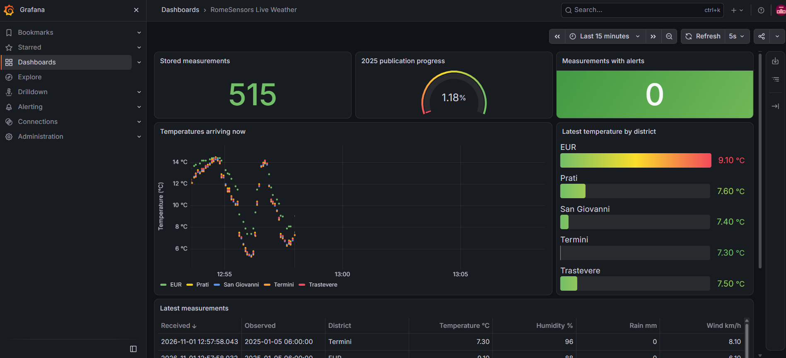
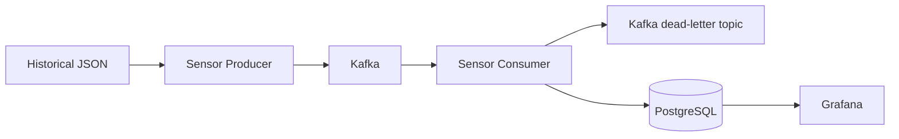

# RomeSensors



## Purpose and scope

RomeSensors is a teaching prototype for showing how environmental observations can
move through a streaming data platform. It can support exploratory analysis of weather
conditions by district and demonstrate the technical basis for a municipal monitoring
system. The current dataset contains temperature, relative humidity, precipitation and wind
speed.

## Stakeholders and requirements

The value of the platform depends on what each stakeholder needs from the data.

| Stakeholder | Main need | Data or output provided |
|---|---|---|
| Municipal urban-planning teams | Compare weather conditions across areas and time periods | District, coordinates, observation time and weather measurements |
| Environmental and civil-protection teams | Identify potentially dangerous conditions | Configurable temperature, wind and precipitation alert flags |
| Data-platform operators | Check ingestion progress, failures and duplicates | Publication/arrival timestamps, Grafana progress panels and a Kafka dead-letter topic |
| Researchers and students | Inspect reproducible data and its origin | Raw historical observations, source URL and source coordinates |

Before using the system outside this prototype, the stakeholders must agree on:

- which districts, pollutants and weather variables are required;
- the spatial resolution and whether observations come from physical sensors or models;
- the update frequency, acceptable delay and data-quality targets;
- alert thresholds, retention time and the queries or exports needed by each team.

## Architecture



| Service | Purpose |
|---|---|
| `sensor-producer` | Reads and publishes the historical JSON data |
| `kafka` | Transports weather events |
| `sensor-consumer` | Validates events and stores them in PostgreSQL |
| `postgres` | Stores sensors, measurements and alert flags |
| `grafana` | Displays publication progress and incoming data |

Every five seconds, the producer publishes one event for each of the five districts.
Stable UUIDs and `UNIQUE(sensor_id, observed_at)` prevent duplicate database rows.

## Data and expected volume

The included dataset represents one hourly observation for each district during 2025.

| Item | Amount |
|---|---:|
| Districts / simulated sensors | 5 |
| Observations per sensor | 8,760 |
| Expected measurements | 43,800 |
| Events published every cycle | 5 |
| Default cycle interval | 5 seconds |
| Kafka retention | 7 days by default |

Each measurement stores three timestamps: when the weather was observed, when the
event was published and when it reached PostgreSQL. It also stores the source and
coordinates so that a result can be traced back to its origin.

## Queries and indexes

The Grafana dashboard represents the main access patterns:

- total rows and ingestion progress against the expected 43,800 measurements;
- number of measurements that triggered at least one alert;
- temperature over arrival time, split by district;
- latest temperature for every district;
- the 20 most recently received measurements.

Municipal or research users can also aggregate the historical observation time. For
example, this query returns daily averages by district:

```sql
SELECT
    s.district,
    date_trunc('day', m.observed_at) AS day,
    avg(m.temperature) AS average_temperature,
    avg(m.relative_humidity) AS average_humidity,
    sum(m.precipitation) AS total_precipitation
FROM measurements m
JOIN sensors s ON s.sensor_id = m.sensor_id
GROUP BY s.district, day
ORDER BY day, s.district;
```

The schema in [`database/init.sql`](database/init.sql) uses:

- a primary-key index on `event_id` for event identity;
- the index created by `UNIQUE(sensor_id, observed_at)` for duplicate prevention and
  per-sensor time-series queries;
- `measurements_observed_at_idx` for filtering and aggregating by observation time.

## Running the project

Docker Desktop or Docker Engine with Compose is required.

```sh
docker compose up --build -d
docker compose ps
```

The input dataset is stored in `data/historical`, with one Open-Meteo JSON file for
each district.

Default access:

- Grafana: [http://localhost:3000](http://localhost:3000), username `admin`, password `admin`;
- PostgreSQL: `localhost:55432`, database/user `romesensors`, password `romesensors_local`;
- Kafka: `localhost:9092`.

The `RomeSensors Live Weather` dashboard is provisioned automatically and refreshes
every five seconds.

To change ports, credentials, dates or the publishing interval, copy `.env.example` to
`.env` and edit the values.

## Useful commands

```sh
docker compose logs -f sensor-producer sensor-consumer grafana
docker compose down
```

To also delete the persistent Kafka, PostgreSQL and Grafana data:

```sh
docker compose down -v
```

